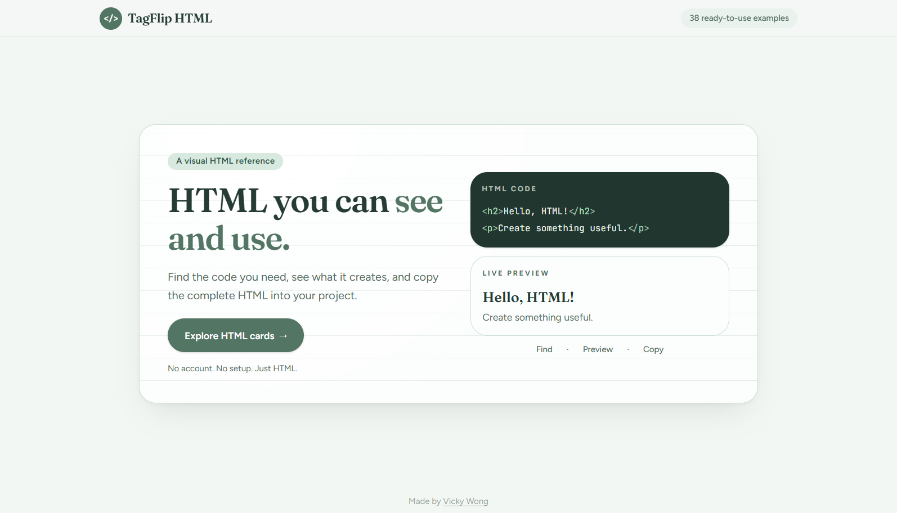
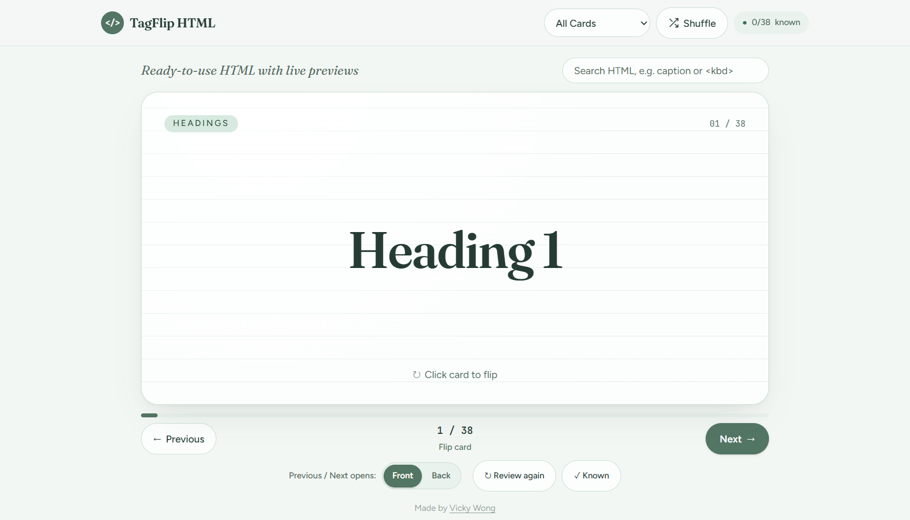
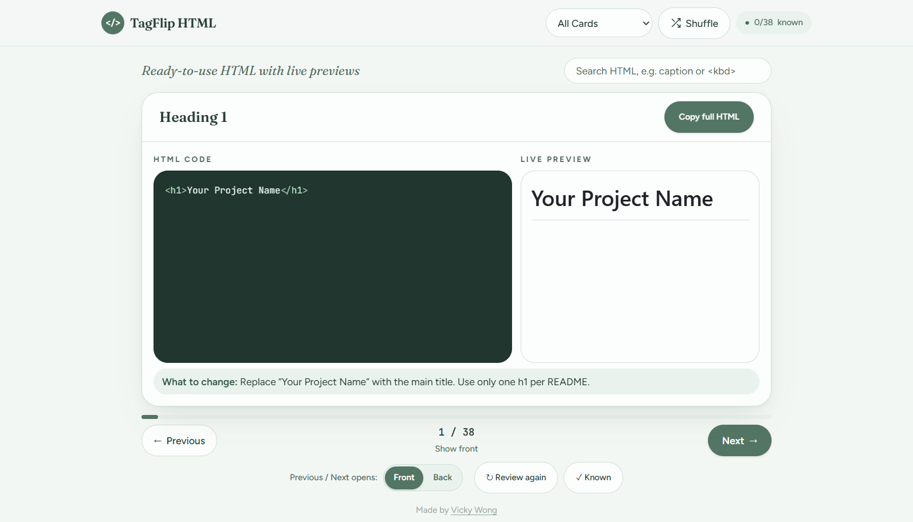

  <h1>🃏 TagFlip HTML </h1>

  

    Flashcards for learning HTML one flip at a time with practical markup, live previews, and copyable code snippets.
  

<h2>📑 Table of Contents</h2>

<ul>
  <li><a href="#objective">Objective</a></li>
  <li><a href="#project-details">Project Details</a></li>
  <li><a href="#instructions">Instructions</a></li>
  <li><a href="#flashcard-topics">Flashcard Topics</a></li>
  <li><a href="#how-to-use">How to Use</a></li>
  <li><a href="#app">App</a></li>
  <li><a href="#images">Images</a></li>
  <li><a href="#notes">Notes</a></li>
</ul>

<h2 id="objective">🎯 Objective</h2>

  This project makes it easier for beginners to learn HTML by showing each example
  as both code and preview. The flashcards focus on useful markup with complete snippets and plain-language notes about
  what to customize. Designed with Lovable, ChatGPT, and Claude to create a hands-on studying tool.

<h2 id="project-details">🛠️ Project Details</h2>

  <strong>Workflow:</strong> Claude → Lovable → ChatGPT

  <strong>Tools:</strong> Lovable, ChatGPT, Claude

  <strong>Models:</strong> ChatGPT 6.1 Sol (2026), Claude Sonnet 4.6 (2026)

  <strong>Format:</strong> Browser App

  <strong>Content:</strong> 38 practical HTML flashcards across seven topics

<h2 id="instructions">📋 Instructions </h2>

  Each flashcard introduces one HTML pattern. Flip it to compare the complete
  code with a live preview, then copy the snippet and adapt its text, links,
  or file paths for your own files.

<ul>
  <li>Filter the deck by topic or shuffle the cards.</li>
  <li>Mark cards as <strong>Known</strong> or <strong>Review again</strong> to track study progress.</li>
  <li>Use the left and right arrow keys to move between cards, and Enter or Space to flip a focused card.</li>
  <li>Study on desktop or mobile with a responsive layout.</li>
</ul>

<h2 id="flashcard-topics">🗂️ Flashcard Topics</h2>

<table>
  <tr>
    <th>Topic</th>
    <th>Examples</th>
  </tr>
  <tr>
    <td>Headings</td>
    <td>Heading levels from <code>&lt;h1&gt;</code> through <code>&lt;h4&gt;</code></td>
  </tr>
  <tr>
    <td>Text</td>
    <td>Paragraphs, emphasis, line breaks, dividers, and quotes</td>
  </tr>
  <tr>
    <td>Lists</td>
    <td>Bulleted, numbered, and nested lists</td>
  </tr>
  <tr>
    <td>Links</td>
    <td>Websites, PDFs, folders, email links, and section anchors</td>
  </tr>
  <tr>
    <td>Images &amp; Tables</td>
    <td>Images, galleries, clickable previews, and data tables</td>
  </tr>
  <tr>
    <td>README Layout</td>
    <td>Centered title blocks, link rows, and a starter README layout</td>
  </tr>
  <tr>
    <td>Extras</td>
    <td>Expandable sections, inline code, keyboard keys, and HTML entities</td>
  </tr>
</table>

<h2 id="how-to-use">🪄 How to Use</h2>

<ol>
  <li>Choose a topic or browse all cards.</li>
  <li>Read the title on the front of a card, then select it to flip.</li>
  <li>Compare the HTML Code with the Live Preview.</li>
  <li>Select <strong>Copy code</strong> and replace the example text or paths with your own.</li>
  <li>Mark the card Known or Review again to track what you want to study.</li>
</ol>

<h2 id="app">🖥️ App</h2>

  <a href="https://tagflip-html.lovable.app">
    Launch App
  </a>

<h2 id="images">🖼️ Images</h2>

<h3>Home</h3>

<table>
  <tr>
    <td>
      
    </td>
  </tr>
</table>

<h3>Front Flashcard</h3>

<table>
  <tr>
    <td>
      
    </td>
  </tr>
</table>

<h3>Back Flashcard</h3>

<table>
  <tr>
    <td>
      
    </td>
  </tr>
</table>

<h2 id="notes">🟩 Notes</h2>

  Study progress is saved in your browser using <code>localStorage</code>;
  it does not automatically sync between devices. Preview images use
  placeholders, so update their paths to real image files when copying examples.
  GitHub sanitizes HTML, and some markup or styling may look different in a
  README than it does in the app preview.

  

    <a href="https://github.com/redefiningvicky/redefiningvicky">
      Back to Portfolio
    </a>
  

